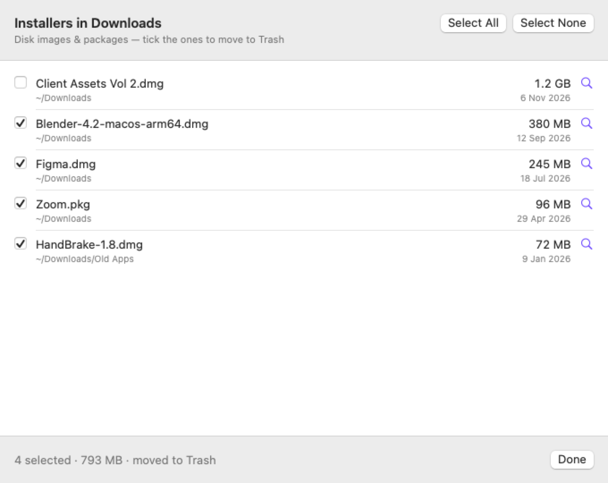
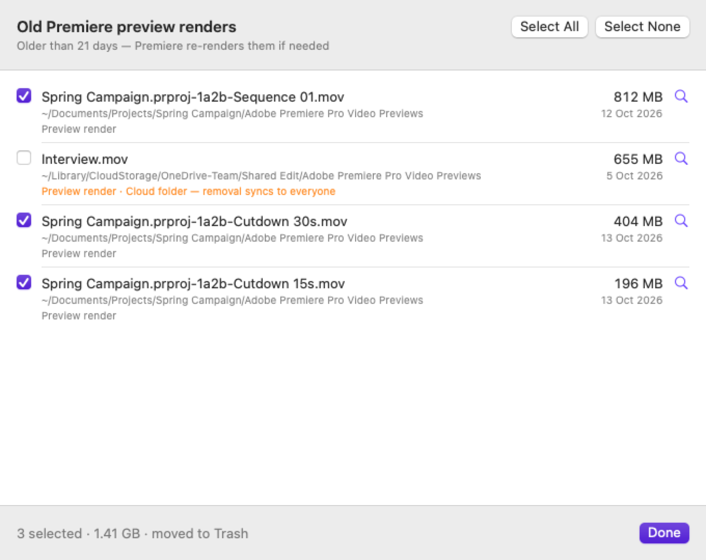
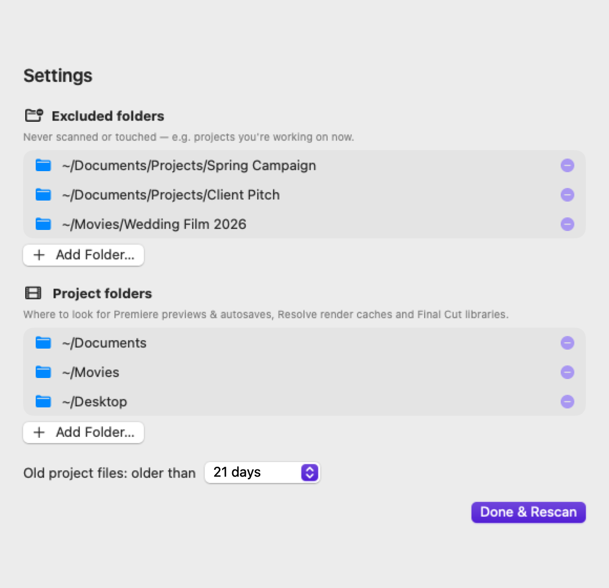
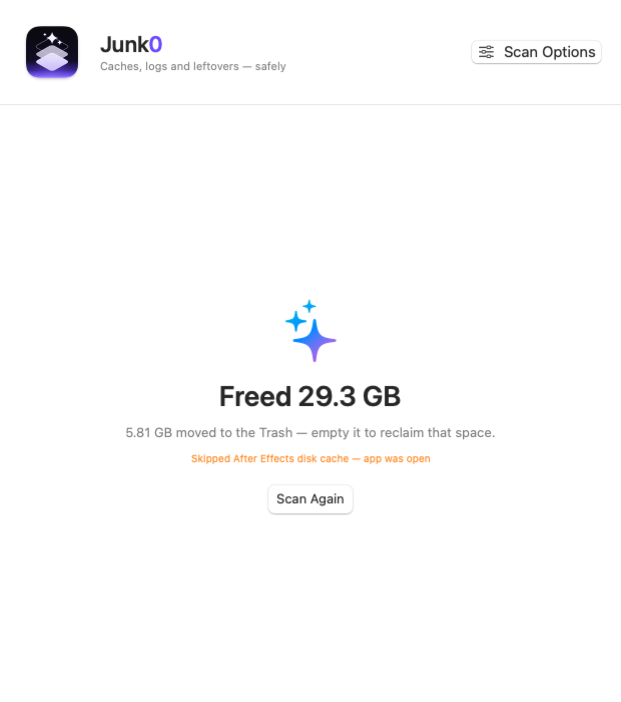

<p align="center">
  
</p>

<h1 align="center">Junk0</h1>

<p align="center">
  <b>A careful, native macOS app that finds the caches, logs and leftovers eating your disk —<br>
  and removes only what is safe, only after you confirm.</b>
</p>

<p align="center">
  <a href="../../releases/latest">Download</a> ·
  <a href="docs/USER_GUIDE.md">User Guide</a> ·
  <a href="docs/SAFETY.md">Safety model</a> ·
  <a href="docs/BUILDING.md">Build from source</a> ·
  <a href="design/README.md">Design evolution</a> ·
  <a href="CHANGELOG.md">Changelog</a>
</p>

<p align="center">
  
  
  
  
  
</p>

<p align="center">
  <picture>
    <source media="(prefers-color-scheme: dark)" srcset="docs/screenshots/main-dark.png">
    
  </picture>
</p>

---

## Table of contents

- [Why this exists](#why-this-exists)
- [Highlights](#highlights)
- [Screenshots](#screenshots)
- [What it cleans](#what-it-cleans)
- [Who it's for — use cases](#who-its-for--use-cases)
- [Install](#install)
- [Using it](#using-it)
- [How it works](#how-it-works)
- [Safety & privacy](#safety--privacy)
- [FAQ](#faq)
- [Build from source](#build-from-source)
- [Project layout](#project-layout)
- [Roadmap](#roadmap)
- [Contributing](#contributing)
- [License & disclaimer](#license--disclaimer)

---

## Why this exists

Creative apps, browsers and developer tools quietly pile up enormous amounts of data in hidden folders.
On the Mac this app was first built for, a disk check found:

| Found | Size |
|---|---|
| After Effects **log files** (one folder!) | **133 GB** |
| After Effects disk cache (stable + beta) | 148 GB |
| Adobe Media Cache & Peak files | 16 GB |
| Other caches, developer caches, logs, old installers | ~30 GB |
| **Freed in the first clean** | **327 GB** (free space went from 83 GB to 412 GB) |

None of it was needed — and none of it was visible in Finder. General-purpose "cleaner" apps either missed it or
wanted to delete far more than was safe. Junk0 was written to do one thing well: **show exactly where the space
went, let you decide, and never touch your own work.**

## Highlights

- 🔍 **One scan, everything visible.** Every group shows its size, sorted largest first.
- ✋ **Nothing happens without you.** Scanning is read-only; the confirmation says exactly what's deleted and what goes to the Trash.
- 🔒 **Open apps are protected.** Caches of running apps are skipped — and re-checked right before cleaning.
- 🗂️ **Review windows** for real files: installers, old Adobe versions, Premiere previews & autosaves, unusual file names.
- 🗑️ **Real files go to the Trash**, recoverable with *Put Back*. Only regenerable caches and logs are deleted outright.
- 📁 **Excluded folders.** Working on three projects? Exclude them and the app never looks inside.
- 🎬 **Made for video people.** After Effects disk cache & logs, Media Cache, Premiere previews and autosaves older than *N* days.
- ☁️ **Cloud-aware.** Files in OneDrive / iCloud are flagged and never pre-selected — removal would sync to your whole team.
- 🛡️ **Private by construction.** No network code, no analytics, no admin password, no background process.
- 🌗 **Feels like macOS.** Native SwiftUI, light & dark mode, universal (Apple Silicon + Intel).

## Screenshots

| | |
|---|---|
|  **Main window** — groups sorted by size; a locked group (After Effects is open); switches for caches, *Review…* for files. |  **Dark mode** — follows your system appearance automatically. |
|  **Installers review** — tick individual `.dmg`/`.pkg` files; 🔍 shows each one in Finder. |  **Premiere previews** — renders older than 21 days; the shared OneDrive file is flagged and unticked. |
|  **Old Adobe versions** — settings and plugin data of versions you've upgraded from; newest is always kept. |  **Settings** — excluded folders, Premiere project folders, age for old files. |
|  **Unusual file names** — hidden line breaks are shown as ⏎ and never pre-selected. |  **Result** — space freed, space in the Trash, and anything skipped. |

*Screenshots use sample data.*

## What it cleans

| Group | Removed how | Default | Notes |
|---|---|---|---|
| After Effects disk cache | Deleted | On | Locked while After Effects is open |
| After Effects log files | Deleted | On | Locked while After Effects is open |
| Adobe Media Cache + Peak files | Deleted | On | Locked while Premiere, AE or Media Encoder is open |
| Other app caches (`~/Library/Caches`) | Deleted | On | Never Apple's own caches; open apps skipped |
| Chrome / Brave caches | Deleted | On | Logins, bookmarks, history, tabs are kept |
| Microsoft Teams cache | Deleted | On | Locked while Teams is open |
| User log files | Deleted | On | |
| Developer caches (`~/.cache`, npm) | Deleted | On | Packages & AI models re-download when needed |
| Installers in Downloads | **Trash**, after review | **Off** | A `.dmg` may hold real work — you decide |
| Old Adobe version leftovers | **Trash**, after review | On | Highest version always kept |
| Old Premiere preview renders | **Trash**, after review | On | Older than 14–90 days; cloud files off |
| Old Premiere autosaves | **Trash**, after review | **Off** | Older than 14–90 days |
| Unusual file names | **Trash**, after review | **Off** | Hidden characters in the name |

Exact paths and everything that is never touched: **[docs/SAFETY.md](docs/SAFETY.md)**.
Plain-language explanations of every group: **[User Guide §3](docs/USER_GUIDE.md#3-cleaning-groups-one-by-one)**.

## Who it's for — use cases

| You are… | What Junk0 does for you | Guide |
|---|---|---|
| 🎬 **A video editor / motion designer** whose disk keeps filling up | Clears After Effects cache & logs and Adobe Media Cache — often 50–300 GB | [Use case A](docs/USER_GUIDE.md#a-my-disk-is-suddenly-full-and-i-edit-video) |
| 🗂️ **Juggling several live projects** | Exclude the folders you're working in; everything inside is untouchable | [Use case B](docs/USER_GUIDE.md#b-im-in-the-middle-of-three-projects--dont-touch-them) |
| 📼 **Archiving finished Premiere jobs** | Lists preview renders and autosaves older than *N* days, project by project | [Use case C](docs/USER_GUIDE.md#c-clean-up-old-premiere-projects-but-keep-current-ones) |
| 📥 **Someone with a messy Downloads folder** | Finds old installers; you tick the ones to bin | [Use case D](docs/USER_GUIDE.md#d-downloads-is-full-of-installers) |
| 🔁 **A Creative Cloud user after the yearly upgrade** | Removes settings & plugin data of the versions you left behind | [Use case E](docs/USER_GUIDE.md#e-i-upgraded-adobe-creative-cloud-apps) |
| 💻 **A developer** | Clears pip/uv/npm caches and downloaded AI models | [Use case F](docs/USER_GUIDE.md#f-developer-machine-python-node-ai-tools) |
| 🧹 **Anyone wanting monthly maintenance** | Conservative defaults: one click, nothing risky selected | [Use case G](docs/USER_GUIDE.md#g-monthly-maintenance) |
| 👥 **A team sharing OneDrive / iCloud folders** | Cloud files are flagged and never pre-selected | [Use case H](docs/USER_GUIDE.md#h-i-share-a-onedrive--icloud-project-folder-with-a-team) |

## Install

1. Download **`Junk0-<version>.zip`** from the [latest release](../../releases/latest) and unzip it.
2. Drag **Junk0.app** into your **Applications** folder.
3. Open it. Because the app isn't notarized by Apple yet, macOS blocks the first launch:
   open **System Settings → Privacy & Security**, scroll to the message about Junk0 and click **Open Anyway**.
   You only need to do this once.

**Requirements:** macOS 14 Sonoma or later · Apple Silicon or Intel · ~3 MB of disk space.

## Using it

1. **Quit** heavy apps (After Effects, Premiere, browsers, Teams) to include their caches — optional but recommended.
2. **Open Junk0**; it scans automatically (20–60 s).
3. **Switch** cache groups on/off, and click **Review…** on file groups to pick individual files.
4. Use **⚙ Settings** to add excluded folders, choose Premiere project folders and the age for old Premiere files.
5. Click **Clean**, read the confirmation, confirm.
6. **Empty the Trash** to reclaim space from reviewed files.

The full walkthrough with screenshots of every screen is in the **[User Guide](docs/USER_GUIDE.md)**.

## How it works

```
 ┌────────────┐     ┌─────────────────────────┐     ┌──────────────┐     ┌────────────────────────┐
 │   Scan     │ ──▶ │ Classify & protect      │ ──▶ │  You decide  │ ──▶ │ Clean                  │
 │ read-only  │     │ • skip excluded folders │     │ • switches   │     │ • re-check open apps   │
 │ sizes only │     │ • skip open apps' caches│     │ • Review…    │     │ • caches → deleted     │
 │            │     │ • keep newest versions  │     │ • confirm    │     │ • files  → Trash       │
 │            │     │ • flag cloud / odd names│     │              │     │ • report freed space   │
 └────────────┘     └─────────────────────────┘     └──────────────┘     └────────────────────────┘
```

- **`Sources/Engine.swift`** contains all scanning, safety and cleaning logic, with no UI. Every path is a native
  `URL` — there is no shell, so file names can't be misinterpreted.
- **`Sources/App.swift`** is the SwiftUI interface: main window, review windows and settings.
- Running apps come from `NSWorkspace`; settings are stored in `UserDefaults`.
- Removal uses `FileManager.removeItem` for caches and `FileManager.trashItem` for reviewed files.

## Safety & privacy

| Guarantee | |
|---|---|
| Only inside your home folder | Every path is verified before removal; the home folder itself can never be a target |
| No admin password, ever | System files are physically out of reach |
| Excluded folders are untouchable | Skipped if a path is the folder, inside it, or contains it |
| Open apps are respected | Checked at scan time and again just before cleaning |
| Symlinks are never followed | Only the link itself is ever considered |
| No network, no analytics | The app makes no connections at all |
| Recoverable where it matters | Anything that isn't a regenerable cache goes to the Trash |

Full details, including every path: **[docs/SAFETY.md](docs/SAFETY.md)**.

## FAQ

<details><summary><b>Will I lose browser logins, bookmarks or history?</b></summary>
No. Only cache folders are removed; browser profiles are never touched.
</details>

<details><summary><b>Will I lose Premiere or After Effects projects?</b></summary>
No. Project files are never in a cache group. Autosaves are only listed when older than your chosen age,
are never pre-selected, and go to the Trash.
</details>

<details><summary><b>Will my Adobe settings reset?</b></summary>
Not for the version you use — the newest version's settings are always kept. Only older versions are listed.
</details>

<details><summary><b>Why is a group locked?</b></summary>
Its app is open. Quit the app and press ↻ to rescan.
</details>

<details><summary><b>Why didn't free space rise by the full amount?</b></summary>
Files moved to the Trash still take space until you empty it.
</details>

<details><summary><b>Does it run in the background or phone home?</b></summary>
No and no. It only acts when you click Clean, and has no network code.
</details>

<details><summary><b>Can I undo?</b></summary>
Reviewed files: yes, from the Trash (Put Back). Caches and logs: no — but apps rebuild them automatically.
</details>

More in the [User Guide FAQ](docs/USER_GUIDE.md#9-faq).

## Build from source

```bash
git clone <this repository>
cd Junk0
./scripts/build.sh                  # universal app in build/
./scripts/build.sh --zip            # + release zip
./scripts/build.sh --install        # + copy to ~/Applications
```

No Xcode project or dependencies — just Swift and the macOS SDK. Useful extras:

```bash
"build/Junk0.app/Contents/MacOS/Junk0" --scan-report             # print what a scan finds, delete nothing
open -W -n "build/Junk0.app" --args --render-screens "$PWD/docs/screenshots"   # regenerate screenshots (sample data)
```

Details and troubleshooting: [docs/BUILDING.md](docs/BUILDING.md).

## Project layout

```
Junk0/
├── Sources/
│   ├── Engine.swift        scanning, safety rules, cleaning (no UI)
│   ├── App.swift           SwiftUI: main window, review windows, settings
│   └── Screens.swift       renders documentation screenshots with sample data
├── Resources/
│   ├── Info.plist          bundle id, version, minimum macOS
│   └── AppIcon.icns
├── scripts/build.sh        universal build · install · zip
├── docs/
│   ├── USER_GUIDE.md       every screen, setting, group and use case
│   ├── SAFETY.md           the safety model and every path
│   ├── BUILDING.md         build, release, notarization, troubleshooting
│   ├── screenshots/        light & dark screenshots
│   ├── assets/icon.png
│   └── index.html          GitHub Pages landing page
├── design/                 icon & name design evolution (see design/README.md)
├── CHANGELOG.md
├── CONTRIBUTING.md
└── LICENSE
```

## Roadmap

- [ ] Developer ID signing and Apple notarization (no more *Open Anyway*)
- [ ] Mac App Store edition (sandboxed, folder-access based)
- [ ] Scheduled scans with a notification when junk passes a threshold
- [ ] Set After Effects' maximum disk cache size from inside the app
- [ ] More cleaners: Final Cut Pro, DaVinci Resolve, Xcode DerivedData, Docker
- [ ] Optional premium features (to be decided)

## Contributing

Issues and pull requests are welcome. Safety comes first — please read [CONTRIBUTING.md](CONTRIBUTING.md)
before adding a cleaning rule.

## License & disclaimer

Released under the [MIT License](LICENSE).

Junk0 removes files. It is designed to touch only caches, logs and leftovers, and every rule is documented
in the open, but you use it at your own risk. Keep a backup (Time Machine) of anything you care about.
