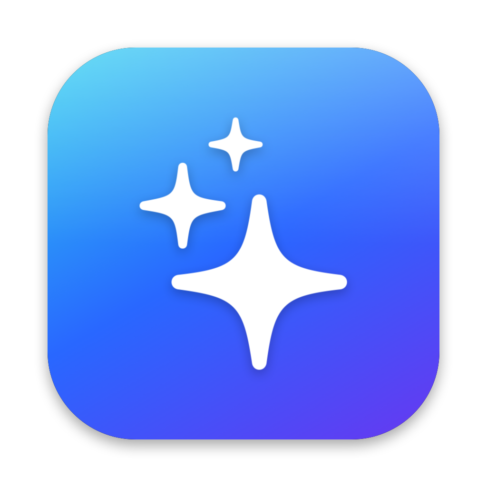
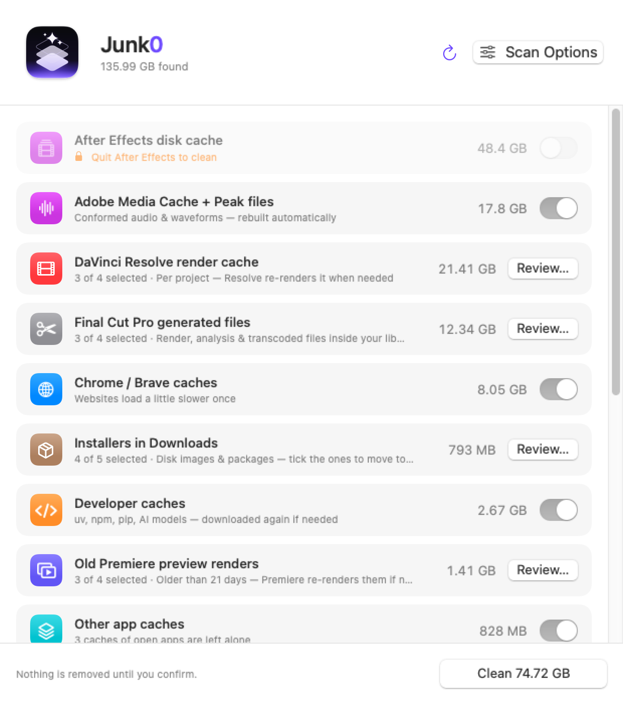
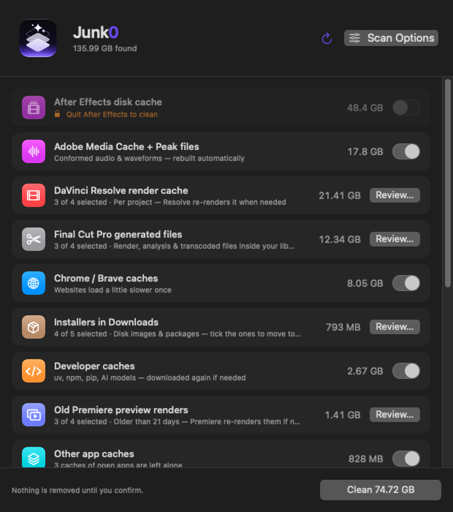
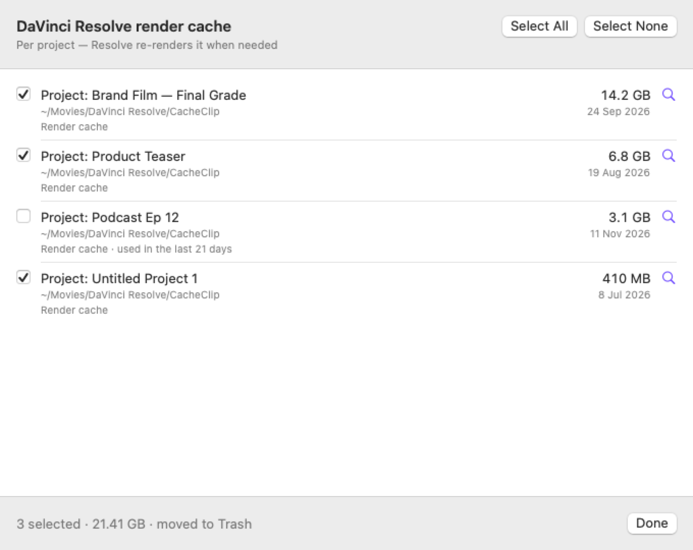
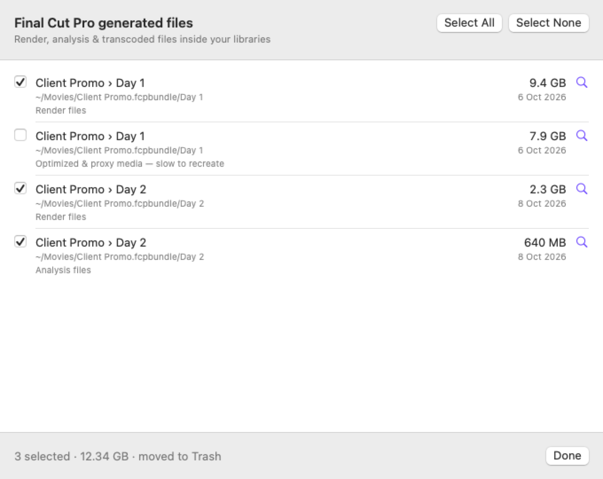
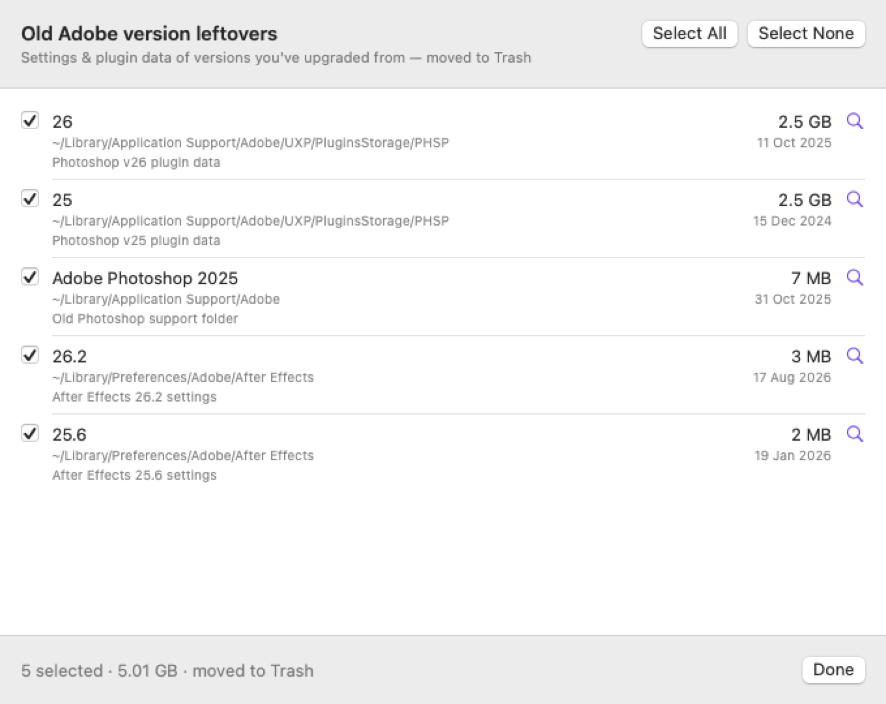

<p align="center">
  
</p>

<h1 align="center">Junk0</h1>

<p align="center">
  <b>A careful, native macOS app that finds the caches, logs and leftovers eating your disk —<br>
  and removes only what is safe, only after you confirm.</b>
</p>

<p align="center">
  <a href="../../releases/latest">Download</a> ·
  <a href="docs/USER_GUIDE.md">User Guide</a> ·
  <a href="docs/SAFETY.md">Safety model</a> ·
  <a href="docs/BUILDING.md">Build from source</a> ·
  <a href="design/README.md">Design evolution</a> ·
  <a href="CHANGELOG.md">Changelog</a>
</p>

<p align="center">
  
  
  
  
  
  
</p>

> [!IMPORTANT]
> **This is a personal side project — please help me test it.**
>
> I built Junk0 to fix the storage mess on my own Mac, because I couldn't find a free tool that did the job.
> It worked well on **my** system, so I made it public for anyone facing the same hassle.
>
> It has **not** been used by many people or tested across many Macs and setups yet, so it is
> **not recommended for business or work-critical machines**.
>
> **Trying it?** Start with the read-only scan, keep a backup of your important projects,
> and then **[tell me what you found](../../issues/new/choose)** — what worked, what looked wrong, and what you'd like added.
> Every report helps make it safer. 🙏

<p align="center">
  <picture>
    <source media="(prefers-color-scheme: dark)" srcset="docs/screenshots/main-dark.png">
    
  </picture>
</p>

---

## Table of contents

- [Help test Junk0](#help-test-junk0)
- [Why this exists](#why-this-exists)
- [Highlights](#highlights)
- [Screenshots](#screenshots)
- [What it cleans](#what-it-cleans)
- [Who it's for — use cases](#who-its-for--use-cases)
- [Install](#install)
- [Using it](#using-it)
- [How it works](#how-it-works)
- [Safety & privacy](#safety--privacy)
- [FAQ](#faq)
- [Build from source](#build-from-source)
- [Project layout](#project-layout)
- [Roadmap](#roadmap)
- [Contributing](#contributing)
- [License & disclaimer](#license--disclaimer)

---

## Help test Junk0

Junk0 started as a fix for my own Mac. So far it has only been tested properly on **one machine — mine** — with After Effects,
Premiere and DaVinci Resolve. Final Cut Pro, CapCut and the App Store app rules were tested with sample files, not real installs.
That's why I'm asking for help.

**How to test safely**

1. **Back up** your important projects (Time Machine or a copy on another drive).
2. Add any **live project folders** to *Settings → Excluded folders*.
3. Open Junk0 and just **look at the scan** — nothing is removed until you click *Clean* and confirm.
4. Open each **Review…** window and check that every listed item really is junk.
5. If you clean, start with the **obvious caches**. Reviewed files go to the **Trash**, so you can *Put Back*.

**What to report** — use the [test report form](../../issues/new/choose):

- ✅ It worked — your Mac (model, macOS version), which apps you use, roughly how much space it found and freed.
- ⚠️ Something looked wrong — an item you think should **not** have been listed, or junk it **missed**.
- 💡 An idea — another app to support, a safety feature, anything that would make it more useful.

Even a one-line "worked fine on my M2 with Resolve" helps. Thank you!

---

## Why this exists

Creative apps, browsers and developer tools quietly pile up enormous amounts of data in hidden folders.
On the Mac this app was first built for, a disk check found:

| Found | Size |
|---|---|
| After Effects **log files** (one folder!) | **133 GB** |
| After Effects disk cache (stable + beta) | 148 GB |
| Adobe Media Cache & Peak files | 16 GB |
| Other caches, developer caches, logs, old installers | ~30 GB |
| **Freed in the first clean** | **327 GB** (free space went from 83 GB to 412 GB) |

None of it was needed — and none of it was visible in Finder. General-purpose "cleaner" apps either missed it or
wanted to delete far more than was safe. Junk0 was written to do one thing well: **show exactly where the space
went, let you decide, and never touch your own work.**

## Highlights

- 🔍 **One scan, everything visible.** Every group shows its size, sorted largest first.
- ✋ **Nothing happens without you.** Scanning is read-only; the confirmation says exactly what's deleted and what goes to the Trash.
- 🔒 **Open apps are protected.** Caches of running apps are skipped — and re-checked right before cleaning.
- 🗂️ **Review windows** for real files: installers, old Adobe versions, Premiere previews & autosaves, Resolve render caches (by project), Final Cut generated files (by library), App Store app caches, unusual file names.
- 🗑️ **Real files go to the Trash**, recoverable with *Put Back*. Only regenerable caches and logs are deleted outright.
- 📁 **Excluded folders.** Working on three projects? Exclude them and the app never looks inside.
- 🎬 **Made for every creative Mac.** Adobe (After Effects, Premiere, Media Encoder, Photoshop, Illustrator), **DaVinci Resolve**, **Final Cut Pro, Motion, Compressor & Logic**, **CapCut**, and App Store apps like **Affinity** and **Pixelmator** — see [supported apps](#supported-apps).
- ☁️ **Cloud-aware.** Files in OneDrive / iCloud are flagged and never pre-selected — removal would sync to your whole team.
- 🛡️ **Private by construction.** No network code, no analytics, no admin password, no background process.
- 🌗 **Feels like macOS.** Native SwiftUI, light & dark mode, universal (Apple Silicon + Intel).

## Screenshots

| | |
|---|---|
|  **Main window** — groups sorted by size; a locked group (After Effects is open); switches for caches, *Review…* for files. |  **Dark mode** — follows your system appearance automatically. |
|  **Installers review** — tick individual `.dmg`/`.pkg` files; 🔍 shows each one in Finder. |  **Premiere previews** — renders older than 21 days; the shared OneDrive file is flagged and unticked. |
|  **DaVinci Resolve** — render cache listed by **project name**; projects used recently stay unticked. |  **Final Cut Pro** — render, analysis and transcoded files per library and event; optimized/proxy media unticked by default. |
|  **Old Adobe versions** — settings and plugin data of versions you've upgraded from; newest is always kept. |  **Settings** — excluded folders, project folders (Premiere, Resolve, Final Cut), age for old files. |
|  **Unusual file names** — hidden line breaks are shown as ⏎ and never pre-selected. |  **Result** — space freed, space in the Trash, and anything skipped. |

*Screenshots use sample data.*

## What it cleans

| Group | Removed how | Default | Notes |
|---|---|---|---|
| After Effects disk cache | Deleted | On | Locked while After Effects is open |
| After Effects log files | Deleted | On | Locked while After Effects is open |
| Adobe Media Cache + Peak files | Deleted | On | Locked while Premiere, AE or Media Encoder is open |
| Other app caches (`~/Library/Caches`) | Deleted | On | Never Apple's own caches; open apps skipped |
| Chrome / Brave caches | Deleted | On | Logins, bookmarks, history, tabs are kept |
| Microsoft Teams cache | Deleted | On | Locked while Teams is open |
| User log files | Deleted | On | |
| Developer caches (`~/.cache`, npm) | Deleted | On | Packages & AI models re-download when needed |
| Installers in Downloads | **Trash**, after review | **Off** | A `.dmg` may hold real work — you decide |
| Old Adobe version leftovers | **Trash**, after review | On | Highest version always kept |
| Old Premiere preview renders | **Trash**, after review | On | Older than 14–90 days; cloud files off |
| Old Premiere autosaves | **Trash**, after review | **Off** | Older than 14–90 days |
| DaVinci Resolve render cache | **Trash**, after review | On (off if used in the last *N* days) | Listed by project name; Fairlight profiles never touched; locked while Resolve is open |
| DaVinci Resolve logs | Deleted | On | Locked while Resolve is open |
| Final Cut Pro generated files | **Trash**, after review | Render & analysis on, optimized/proxy **off** | Same files as *File › Delete Generated Library Files*; locked while Final Cut is open |
| Final Cut, Motion, Compressor & Logic caches | Deleted | On | The only Apple caches Junk0 touches; locked while the app is open |
| CapCut cache | Deleted | On | Only the `Cache` folder — never your projects or drafts |
| App Store app caches (Affinity, Pixelmator, …) | **Trash**, after review | On | Password managers, cloud drives and device-management apps are never listed |
| Unusual file names | **Trash**, after review | **Off** | Hidden characters in the name |

### Supported apps

| App family | What Junk0 finds |
|---|---|
| **Adobe** — After Effects, Premiere Pro, Media Encoder, Photoshop, Illustrator | Disk cache, logs, Media Cache & Peak files, old previews & autosaves, old-version leftovers |
| **DaVinci Resolve** | Render cache per project, logs |
| **Apple pro apps** — Final Cut Pro, Motion, Compressor, Logic Pro | Final Cut generated library files; app caches |
| **CapCut** | Effects & smart-crop cache |
| **App Store / sandboxed apps** — Affinity, Pixelmator Pro and others | Their cache folders |
| **Everything else** — Figma, Blender, Cinema 4D, Spotify, Slack, Zoom, Firefox, Edge, VS Code… | Standard app caches (`~/Library/Caches`), logs, developer caches, installers |

Exact paths and everything that is never touched: **[docs/SAFETY.md](docs/SAFETY.md)**.
Plain-language explanations of every group: **[User Guide §3](docs/USER_GUIDE.md#3-cleaning-groups-one-by-one)**.

## Who it's for — use cases

| You are… | What Junk0 does for you | Guide |
|---|---|---|
| 🎬 **A video editor / motion designer** whose disk keeps filling up | Clears After Effects cache & logs and Adobe Media Cache — often 50–300 GB | [Use case A](docs/USER_GUIDE.md#a-my-disk-is-suddenly-full-and-i-edit-video) |
| 🗂️ **Juggling several live projects** | Exclude the folders you're working in; everything inside is untouchable | [Use case B](docs/USER_GUIDE.md#b-im-in-the-middle-of-three-projects--dont-touch-them) |
| 📼 **Archiving finished Premiere jobs** | Lists preview renders and autosaves older than *N* days, project by project | [Use case C](docs/USER_GUIDE.md#c-clean-up-old-premiere-projects-but-keep-current-ones) |
| 📥 **Someone with a messy Downloads folder** | Finds old installers; you tick the ones to bin | [Use case D](docs/USER_GUIDE.md#d-downloads-is-full-of-installers) |
| 🔁 **A Creative Cloud user after the yearly upgrade** | Removes settings & plugin data of the versions you left behind | [Use case E](docs/USER_GUIDE.md#e-i-upgraded-adobe-creative-cloud-apps) |
| 💻 **A developer** | Clears pip/uv/npm caches and downloaded AI models | [Use case F](docs/USER_GUIDE.md#f-developer-machine-python-node-ai-tools) |
| 🧹 **Anyone wanting monthly maintenance** | Conservative defaults: one click, nothing risky selected | [Use case G](docs/USER_GUIDE.md#g-monthly-maintenance) |
| 🎞️ **A DaVinci Resolve or Final Cut editor** | Finds render caches by project and generated files by library — often tens of GB | [Use case I](docs/USER_GUIDE.md#i-i-edit-in-davinci-resolve-or-final-cut-pro) |
| 🎨 **An Affinity, Pixelmator or CapCut user** | Clears their caches, never your projects | [Use case J](docs/USER_GUIDE.md#j-i-use-affinity-pixelmator-or-capcut) |
| 👥 **A team sharing OneDrive / iCloud folders** | Cloud files are flagged and never pre-selected | [Use case H](docs/USER_GUIDE.md#h-i-share-a-onedrive--icloud-project-folder-with-a-team) |

## Install

1. Download **`Junk0-<version>.zip`** from the [latest release](../../releases/latest) and unzip it.
2. Drag **Junk0.app** into your **Applications** folder.
3. Open it. Because the app isn't notarized by Apple yet, macOS blocks the first launch:
   open **System Settings → Privacy & Security**, scroll to the message about Junk0 and click **Open Anyway**.
   You only need to do this once.

**Requirements:** macOS 14 Sonoma or later · Apple Silicon or Intel · ~3 MB of disk space.

## Using it

1. **Quit** heavy apps (After Effects, Premiere, browsers, Teams) to include their caches — optional but recommended.
2. **Open Junk0**; it scans automatically (20–60 s).
3. **Switch** cache groups on/off, and click **Review…** on file groups to pick individual files.
4. Use **Scan Options** (top right) to add excluded folders, choose project folders and the age for old project files.
5. Click **Clean**, read the confirmation, confirm.
6. **Empty the Trash** to reclaim space from reviewed files.

The full walkthrough with screenshots of every screen is in the **[User Guide](docs/USER_GUIDE.md)**.

## How it works

```
 ┌────────────┐     ┌─────────────────────────┐     ┌──────────────┐     ┌────────────────────────┐
 │   Scan     │ ──▶ │ Classify & protect      │ ──▶ │  You decide  │ ──▶ │ Clean                  │
 │ read-only  │     │ • skip excluded folders │     │ • switches   │     │ • re-check open apps   │
 │ sizes only │     │ • skip open apps' caches│     │ • Review…    │     │ • caches → deleted     │
 │            │     │ • keep newest versions  │     │ • confirm    │     │ • files  → Trash       │
 │            │     │ • flag cloud / odd names│     │              │     │ • report freed space   │
 └────────────┘     └─────────────────────────┘     └──────────────┘     └────────────────────────┘
```

- **`Sources/Engine.swift`** contains all scanning, safety and cleaning logic, with no UI. Every path is a native
  `URL` — there is no shell, so file names can't be misinterpreted.
- **`Sources/App.swift`** is the SwiftUI interface: main window, review windows and settings.
- Running apps come from `NSWorkspace`; settings are stored in `UserDefaults`.
- Removal uses `FileManager.removeItem` for caches and `FileManager.trashItem` for reviewed files.

## Safety & privacy

| Guarantee | |
|---|---|
| Only inside your home folder | Every path is verified before removal; the home folder itself can never be a target |
| No admin password, ever | System files are physically out of reach |
| Excluded folders are untouchable | Skipped if a path is the folder, inside it, or contains it |
| Open apps are respected | Checked at scan time and again just before cleaning |
| Symlinks are never followed | Only the link itself is ever considered |
| No network, no analytics | The app makes no connections at all |
| Recoverable where it matters | Anything that isn't a regenerable cache goes to the Trash |

Full details, including every path: **[docs/SAFETY.md](docs/SAFETY.md)**.

## FAQ

<details><summary><b>Will I lose browser logins, bookmarks or history?</b></summary>
No. Only cache folders are removed; browser profiles are never touched.
</details>

<details><summary><b>Will I lose Premiere or After Effects projects?</b></summary>
No. Project files are never in a cache group. Autosaves are only listed when older than your chosen age,
are never pre-selected, and go to the Trash.
</details>

<details><summary><b>Will my Adobe settings reset?</b></summary>
Not for the version you use — the newest version's settings are always kept. Only older versions are listed.
</details>

<details><summary><b>Why is a group locked?</b></summary>
Its app is open. Quit the app and press ↻ to rescan.
</details>

<details><summary><b>Why didn't free space rise by the full amount?</b></summary>
Files moved to the Trash still take space until you empty it.
</details>

<details><summary><b>Has it been widely tested? Can I use it at work?</b></summary>
Not yet. It's a personal side project that has been tested properly on one Mac (mine). It is not recommended for business or
work-critical machines. If you try it, back up first and please <a href="../../issues/new/choose">share what you found</a>.
</details>

<details><summary><b>Does it run in the background or phone home?</b></summary>
No and no. It only acts when you click Clean, and has no network code.
</details>

<details><summary><b>Can I undo?</b></summary>
Reviewed files: yes, from the Trash (Put Back). Caches and logs: no — but apps rebuild them automatically.
</details>

More in the [User Guide FAQ](docs/USER_GUIDE.md#9-faq).

## Build from source

```bash
git clone <this repository>
cd Junk0
./scripts/build.sh                  # universal app in build/
./scripts/build.sh --zip            # + release zip
./scripts/build.sh --install        # + copy to ~/Applications
```

No Xcode project or dependencies — just Swift and the macOS SDK. Useful extras:

```bash
"build/Junk0.app/Contents/MacOS/Junk0" --scan-report             # print what a scan finds, delete nothing
open -W -n "build/Junk0.app" --args --render-screens "$PWD/docs/screenshots"   # regenerate screenshots (sample data)
```

Details and troubleshooting: [docs/BUILDING.md](docs/BUILDING.md).

## Project layout

```
Junk0/
├── Sources/
│   ├── Engine.swift        scanning, safety rules, cleaning (no UI)
│   ├── App.swift           SwiftUI: main window, review windows, settings
│   └── Screens.swift       renders documentation screenshots with sample data
├── Resources/
│   ├── Info.plist          bundle id, version, minimum macOS
│   └── AppIcon.icns
├── scripts/build.sh        universal build · install · zip
├── docs/
│   ├── USER_GUIDE.md       every screen, setting, group and use case
│   ├── SAFETY.md           the safety model and every path
│   ├── BUILDING.md         build, release, notarization, troubleshooting
│   ├── screenshots/        light & dark screenshots
│   ├── assets/icon.png
│   └── index.html          GitHub Pages landing page
├── design/                 icon & name design evolution (see design/README.md)
├── CHANGELOG.md
├── CONTRIBUTING.md
└── LICENSE
```

## Roadmap

- [ ] Developer ID signing and Apple notarization (no more *Open Anyway*)
- [ ] Mac App Store edition (sandboxed, folder-access based)
- [ ] Scheduled scans with a notification when junk passes a threshold
- [ ] Set After Effects' maximum disk cache size from inside the app
- [x] DaVinci Resolve, Final Cut Pro, Motion, Compressor, Logic, CapCut and App Store app caches (v2.3)
- [x] Labelled **Scan Options** button instead of a gear icon (v2.4)
- [ ] More cleaners: Xcode DerivedData, Docker, Blender & Cinema 4D project caches
- [ ] Optional premium features (to be decided)

## Contributing

Issues and pull requests are welcome. Safety comes first — please read [CONTRIBUTING.md](CONTRIBUTING.md)
before adding a cleaning rule.

## License & disclaimer

Released under the [MIT License](LICENSE).

Junk0 is a **personal side project and an early release**, tested on the author's own Mac only. It removes files.
It is designed to touch only caches, logs and leftovers, and every rule is documented in the open, but you use it at your
own risk and it is not recommended for business or work-critical machines. Keep a backup (Time Machine) of anything you care about.
