# Junk0 — User Guide

> [!IMPORTANT]
> **Personal side project — early release.** Junk0 was built for, and tested properly on, the author’s own Mac. It has not been
> tested across many Macs or setups yet and is **not recommended for business or work-critical machines**. Back up first, start
> with the read-only scan, and please [share what you find](https://github.com/debandjones01012014-a11y/junk0/issues/new/choose).

This guide walks through every screen, every setting and every cleaning group, with real screenshots
and step-by-step use cases. If you only want the safety rules, see [SAFETY.md](SAFETY.md).

> Screenshots use sample data — the file names and sizes are examples, not real files.

## Contents

1. [Quick start (2 minutes)](#1-quick-start-2-minutes)
2. [The main window](#2-the-main-window)
3. [Cleaning groups, one by one](#3-cleaning-groups-one-by-one)
4. [Review windows](#4-review-windows)
5. [Settings: excluded folders, Premiere folders, age](#5-settings)
6. [Confirming and cleaning](#6-confirming-and-cleaning)
7. [Use cases — step by step](#7-use-cases--step-by-step)
8. [How much space can I expect to get back?](#8-how-much-space-can-i-expect-to-get-back)
9. [FAQ](#9-faq)
10. [Troubleshooting](#10-troubleshooting)
11. [Glossary](#11-glossary)

---

## 1. Quick start (2 minutes)

1. **Quit** After Effects, Premiere Pro, Media Encoder, your browsers and Teams. *(Optional — open apps are skipped safely, but you'll clean more if they're closed.)*
2. **Open Junk0.** It starts scanning straight away.
3. **Look at the list.** Every group shows its size. Switches are on for caches that are safe to delete.
4. **Click Review…** on any group that has one, and tick only what you want to remove.
5. **Click Clean** at the bottom right and confirm.
6. **Empty the Trash** if you reviewed files and want that space back too.

That's it. The rest of this guide explains each step in detail.

---

## 2. The main window

  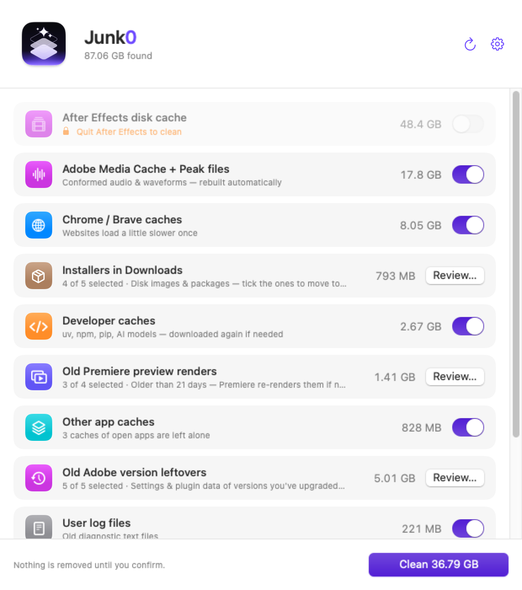
  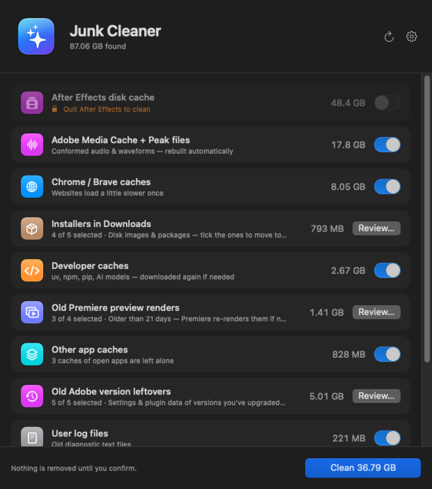

| Area | What it shows / does |
|---|---|
| **Header** | App icon, and the **total junk found** across all groups. |
| **↻ (Scan again)** | Rescans. Use it after quitting an app so its cache becomes cleanable. |
| **⚙ (Settings)** | Excluded folders, project folders and the age for old project files. |
| **Group cards** | One card per group, largest first. Coloured tile = type of junk. |
| **Switch** (cache groups) | On = this group will be deleted when you click Clean. |
| **Review…** (file groups) | Opens a window where you pick files one by one. The card shows *"3 of 4 selected"* and the selected size. |
| **🔒 Quit … to clean** | That app is open, so its cache is locked and the switch is off and disabled. |
| **Clean button** | Shows exactly how much is currently selected. Disabled when nothing is selected. |

While scanning you'll see a spinner. A full scan usually takes **20–60 seconds** — most of that time is
measuring big cache folders and searching your project folders.

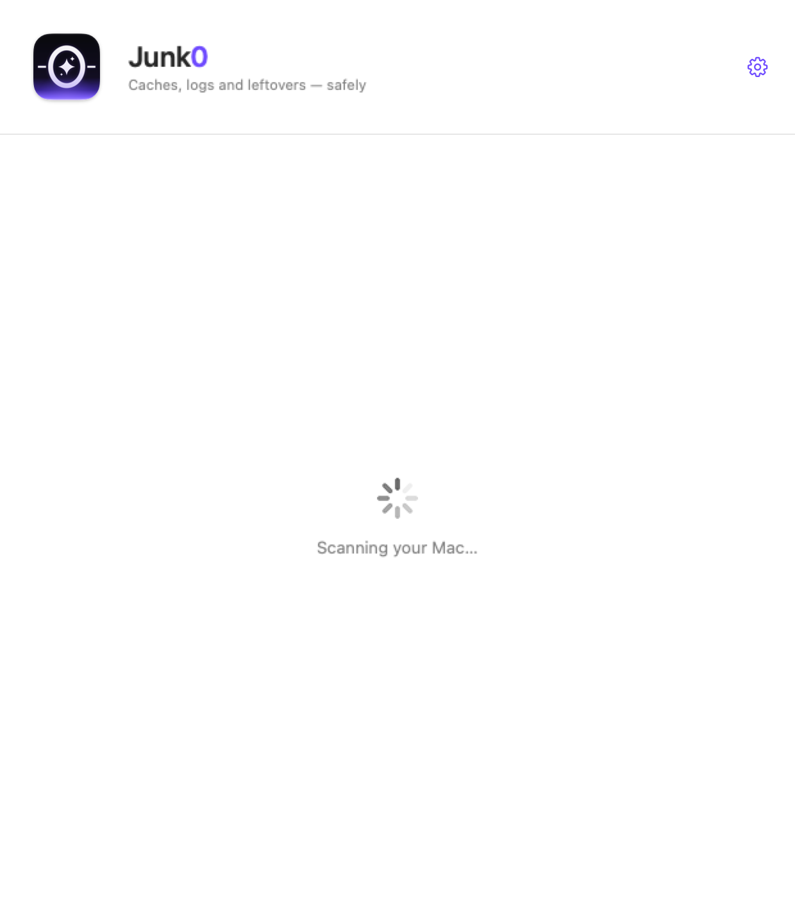

---

## 3. Cleaning groups, one by one

There are two kinds of groups:

- **Cache groups (switch)** — files that apps rebuild on their own. They're **deleted permanently** because keeping them in the Trash would just move the problem.
- **File groups (Review…)** — real files you might want. You pick each one, and they go to the **Trash** so you can still get them back.

### Cache groups

| Group | What it is | What you'll notice after cleaning | Locked while |
|---|---|---|---|
| **After Effects disk cache** | Frames AE rendered for previews (RAM preview spill-over). Often 20–150 GB. | First previews of each comp re-render. | After Effects is open |
| **After Effects log files** | Diagnostic logs AE writes in `Preferences/.../logs`. Can silently grow past 100 GB if a plugin is noisy. | Nothing. | After Effects is open |
| **Adobe Media Cache + Peak files** | "Conformed" audio (`.cfa`) and waveforms (`.pek`) Premiere, AE and Media Encoder build for every imported clip. | Projects re-conform audio on open — a short "Conforming…" status. | Premiere, AE or Media Encoder is open |
| **Other app caches** | Everything in `~/Library/Caches` for apps that aren't open — Photoshop, Premiere's own cache, BorisFX, updaters, installers' leftovers… Apple's own caches are never included. | Apps may start a little slower once. | — (open apps are simply skipped; the card tells you how many) |
| **Chrome / Brave caches** | Cached web pages, images and service-worker storage. **Not** your logins, passwords, bookmarks, history or tabs. | Websites load slightly slower the first visit. | Chrome or Brave is open |
| **Microsoft Teams cache** | Teams' web cache. | Teams starts slightly slower once. | Teams is open |
| **User log files** | Diagnostic text logs in `~/Library/Logs`. | Nothing. | — |
| **Developer caches** | `~/.cache` (uv, pip, Hugging Face / Whisper models, Puppeteer browsers…) and npm's download cache. | Packages and AI models download again the next time a tool needs them. | — |
| **DaVinci Resolve logs** | Resolve's diagnostic logs and crash archives. | Nothing. | DaVinci Resolve is open |
| **Final Cut, Motion, Compressor & Logic caches** | The app caches of Apple's pro apps — the only Apple caches Junk0 ever touches. | The app starts a little slower once. | That app is open |
| **CapCut cache** | `~/Movies/CapCut/User Data/Cache` (effects, smart-crop). **Never** `Projects`, where your drafts live. | Effects re-download when used. | CapCut is open |

### File groups (Review…)

| Group | What it is | Selected by default? |
|---|---|---|
| **Installers in Downloads** | `.dmg` and `.pkg` files up to two folders deep in Downloads. | **No** — a `.dmg` can be a disk image of real work. |
| **Old Adobe version leftovers** | Settings and plugin data from Adobe versions you've upgraded from. The newest version is always kept. | Yes |
| **Old Premiere preview renders** | Render files in `Adobe Premiere Pro Video/Audio Previews` folders older than your chosen age. | Yes (except cloud folders) |
| **Old Premiere autosaves** | `.prproj` copies in `Adobe Premiere Pro Auto-Save` folders older than your chosen age. | **No** |
| **DaVinci Resolve render cache** | One entry per project in each `CacheClip` folder, named by the project. The shared `audio` folder (Fairlight profiles) is never listed. | Yes — **No** for projects used in the last *N* days |
| **Final Cut Pro generated files** | Per library and event: `Render Files`, `Analysis Files` and `Transcoded Media` (optimized & proxy). | Render & analysis yes; **optimized/proxy no** |
| **App Store app caches** | The cache folder of sandboxed apps (Affinity, Pixelmator Pro, …) when larger than 20 MB. Password managers, cloud-drive and device-management apps are never listed. | Yes |
| **Unusual file names** | Any of the above whose name contains hidden characters (line breaks, tabs, leading spaces). | **No** |

Cache groups smaller than 1 MB, and file groups with nothing found, are hidden.

---

## 4. Review windows

Click **Review…** on any file group.

  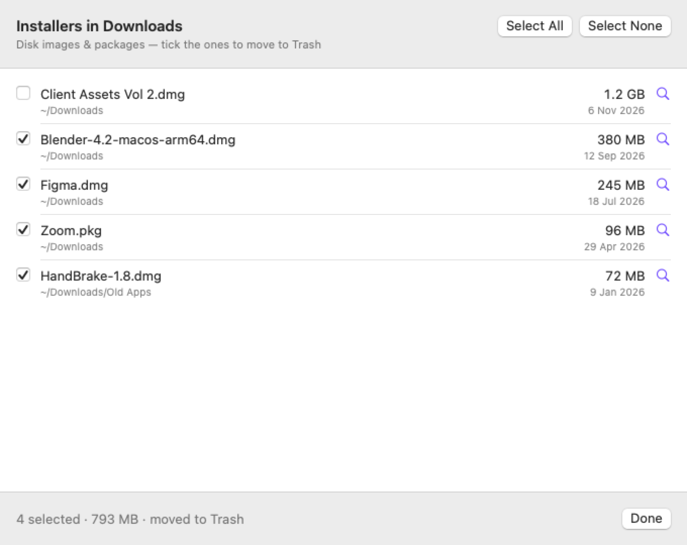
  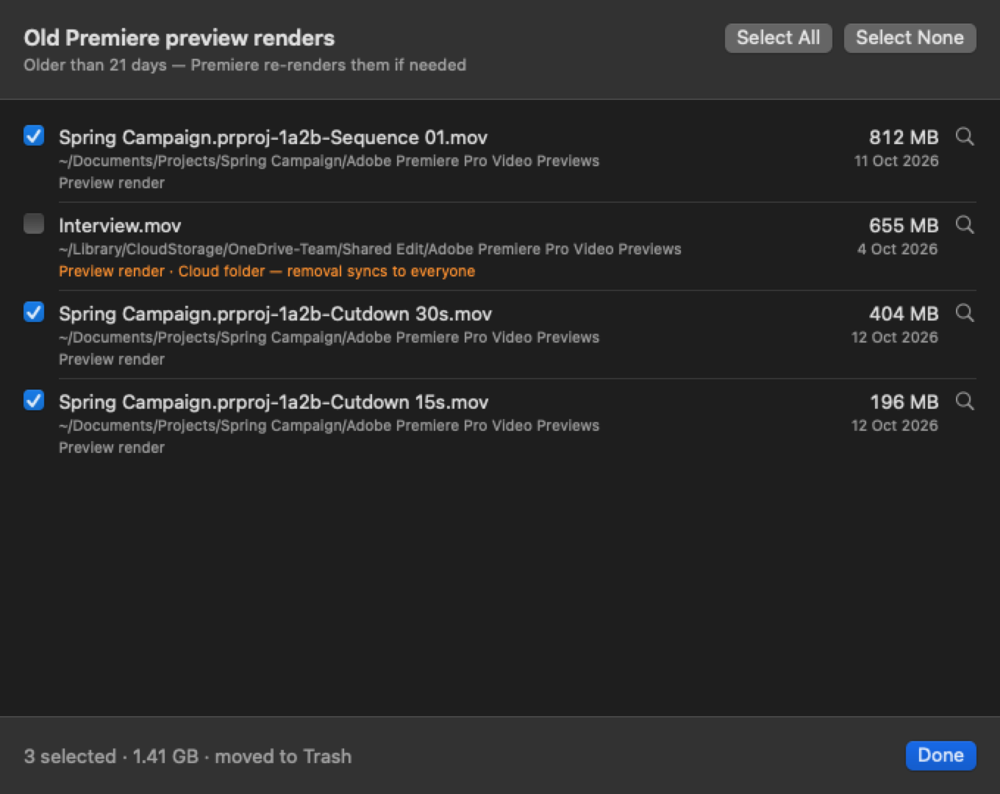

Each row shows:

- **Checkbox** — ticked files are moved to the Trash when you click Clean.
- **File name** and the **folder** it's in (your home folder is shown as `~`).
- **Note** — why it's listed. Orange notes are warnings (cloud folder, unusual name).
- **Size** and **last modified date**.
- **🔍** — reveals the file in Finder so you can check it before deciding.

Buttons: **Select All**, **Select None**, and **Done** (returns to the main window; your ticks are kept).
The footer always shows how many files and how much space are selected.

### Old Adobe versions

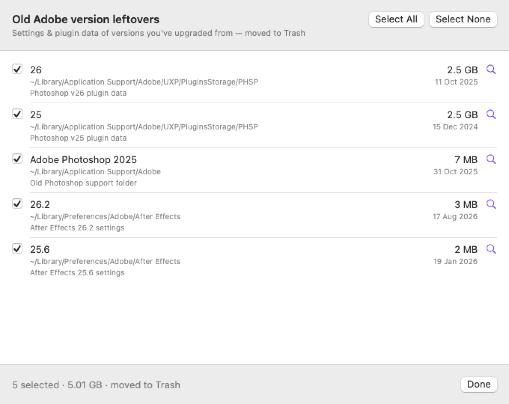

The app looks at the version-numbered folders Adobe creates (for example `After Effects/25.6`, `26.2`, `26.3`)
and lists every one **except the highest**. If you still use an older version side by side, untick it.

### DaVinci Resolve render cache

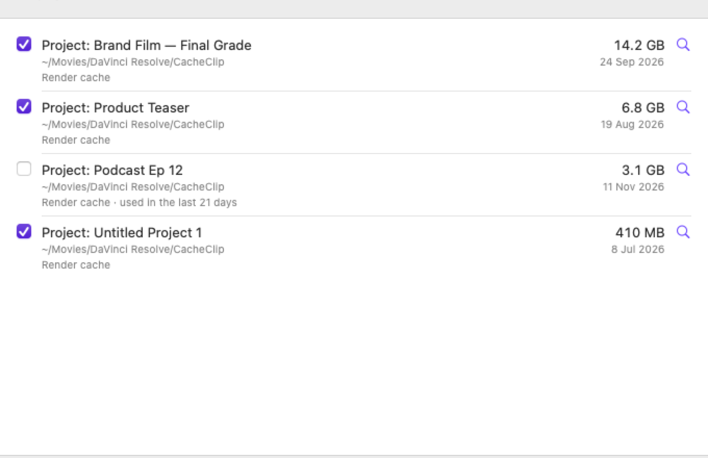

Resolve keeps a render cache per project inside a hidden-looking `CacheClip` folder (by default in
`~/Movies/DaVinci Resolve`, or wherever *Cache Files Location* points). Junk0 reads each project's `Info.txt`, so you see
**project names**, not codes. Projects touched in the last *N* days stay unticked. Resolve rebuilds the cache when you
play or render again. The whole group is locked while Resolve is open. If your cache lives on another drive, add it
under **Project folders** in Settings.

### Final Cut Pro generated files

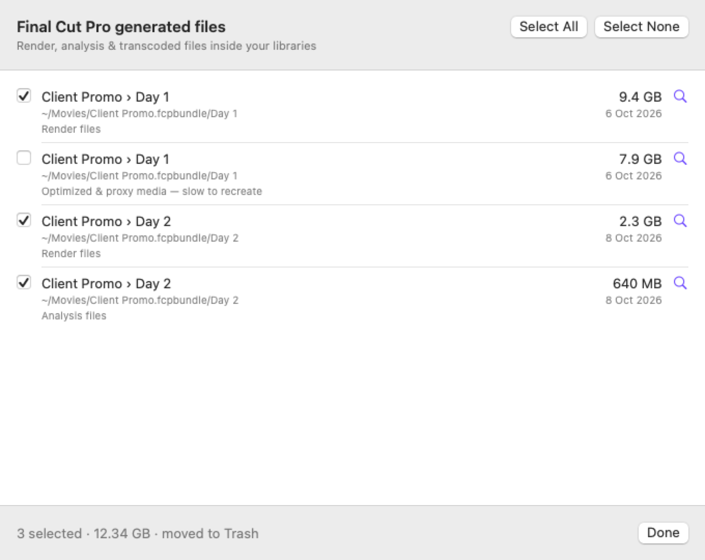

These are the same files Final Cut removes with **File › Delete Generated Library Files**, listed per library and event
so you can choose. **Optimized & proxy media** are unticked by default — recreating them takes time, and if original
media is offline the proxies may be your only playable copy. Final Cut must be closed.

### App Store app caches

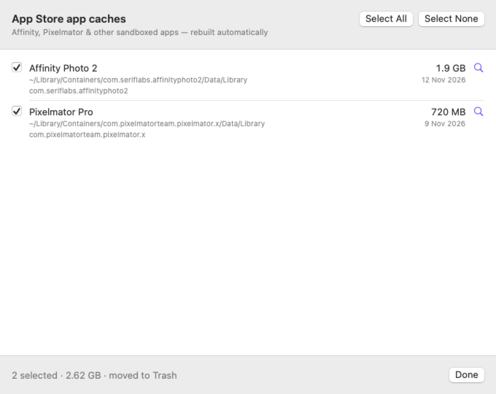

Apps from the Mac App Store keep their caches inside `~/Library/Containers`. Each app is listed by name. Password
managers, cloud-drive providers and device-management tools are never shown. macOS may ask once whether Junk0 may
access data from other apps — that's expected.

### Unusual file names

Some files have invisible characters in their names — usually from a bad download or a copy-paste. They are shown
in quotes with `⏎` where a hidden line break is. They're never pre-selected; use 🔍 to look at them first.

### Cloud folders

If a file is inside a OneDrive or iCloud folder, the note says **"Cloud folder — removal syncs to everyone"** and it
isn't pre-selected. Moving it to your Trash removes it from the shared folder for every person it's shared with.

---

## 5. Settings

Click **⚙** in the top-right corner.

  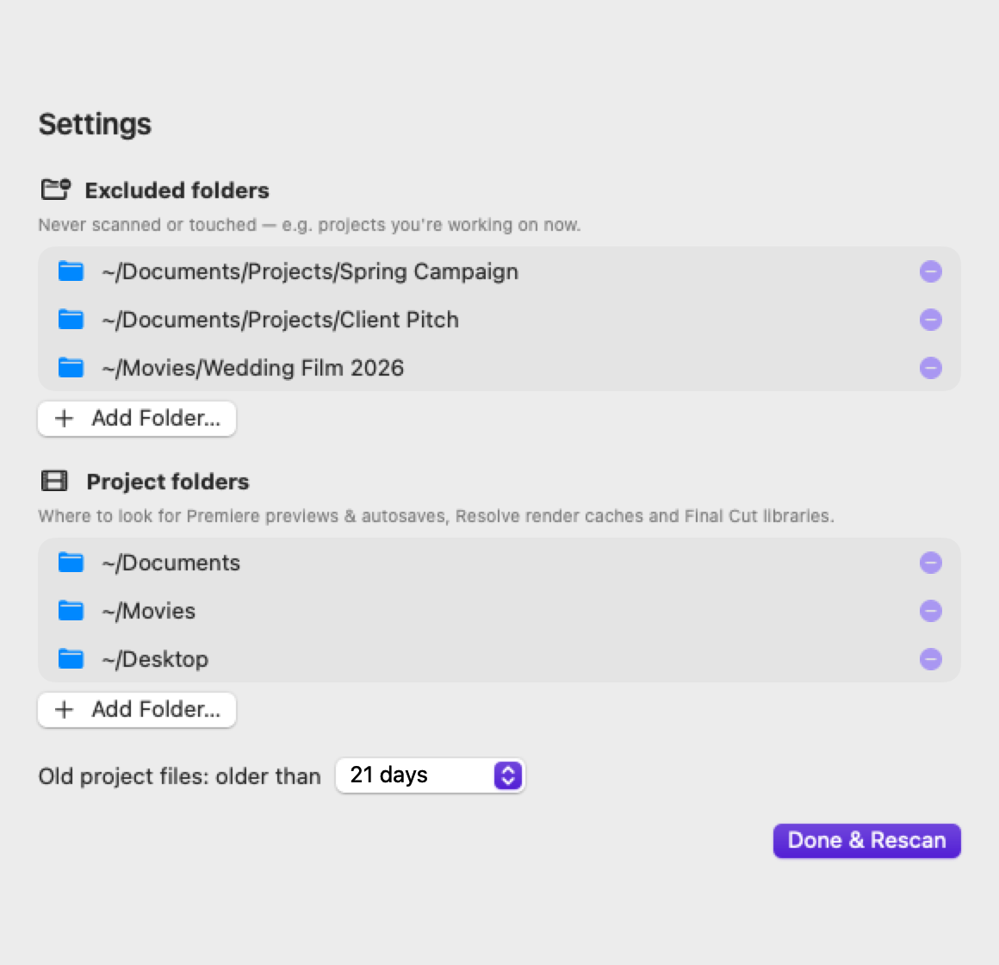
  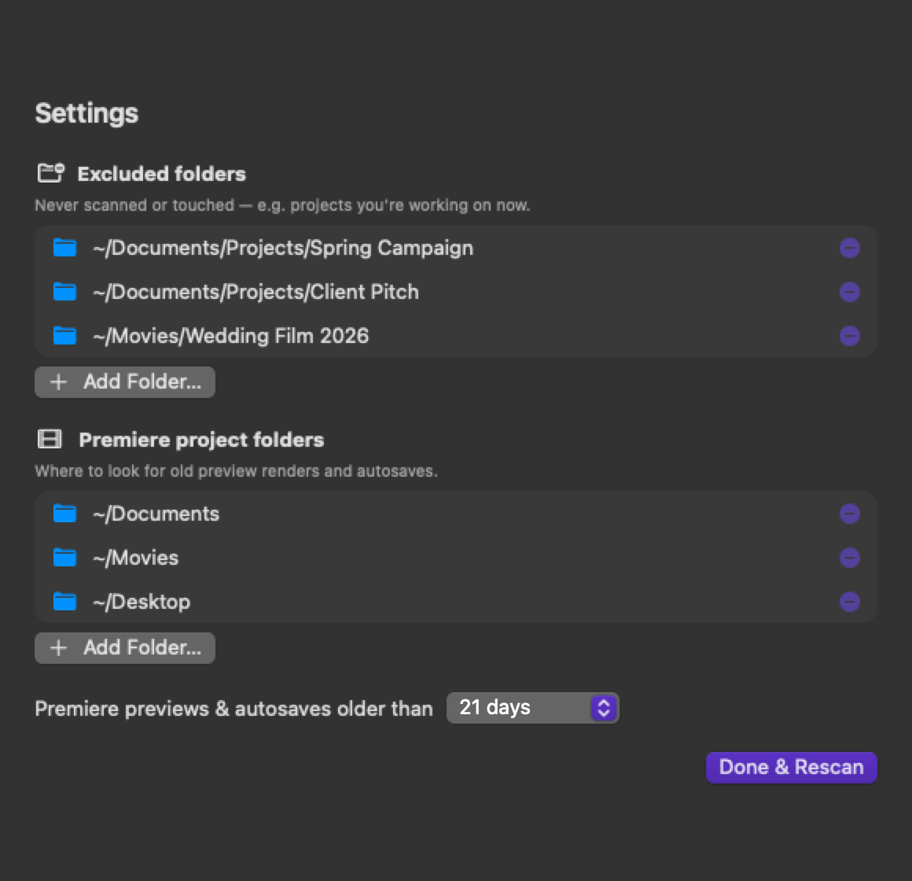

### Excluded folders

Folders in this list are **never scanned and never touched** — not the folder, not anything inside it, and not any
parent folder that contains it.

- **Add Folder…** opens a folder picker. You can select several folders at once (⌘-click).
- **⊖** removes a folder from the list (it doesn't delete the folder itself).
- The list is remembered between launches.

Typical use: the projects you're actively editing, a client delivery folder, a folder of installers you keep on purpose.

### Project folders

Where the app looks for Premiere `… Previews` and `Auto-Save` folders, DaVinci Resolve `CacheClip` folders and
Final Cut Pro libraries (`.fcpbundle`).
Defaults: **Documents, Movies, Desktop**, plus `Documents/Adobe/Premiere Pro`. Add your external or project drives here.

### Age for old project files

Premiere previews and autosaves are listed only when **older than** this; Resolve projects used more recently stay
unticked: **14, 21 (default), 30, 60 or 90 days.**

Click **Done & Rescan** to apply changes.

---

## 6. Confirming and cleaning

When you click **Clean**, a confirmation explains exactly what happens, for example:

> **Clean 36.8 GB?**
> 29.3 GB of caches and logs will be permanently deleted. Apps rebuild these.
> 12 files (5.8 GB) will be moved to the Trash, so you can still recover them.
> Excluded folders and caches of open apps are never touched.

Click **Clean** to go ahead or **Cancel** to go back. Just before removing anything the app checks again which apps
are open — if you opened After Effects in the meantime, its cache is skipped.

  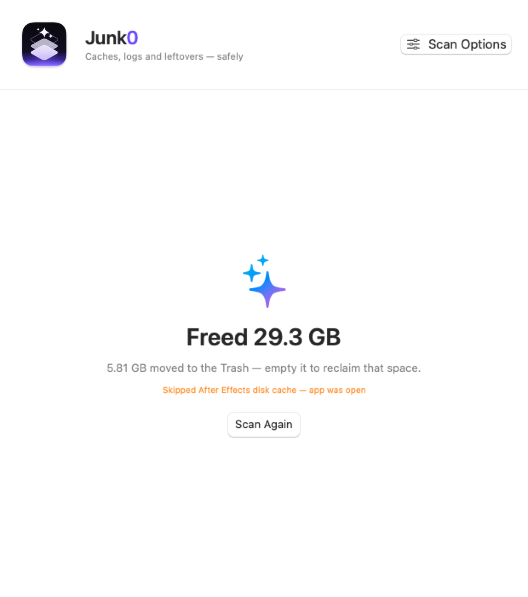
  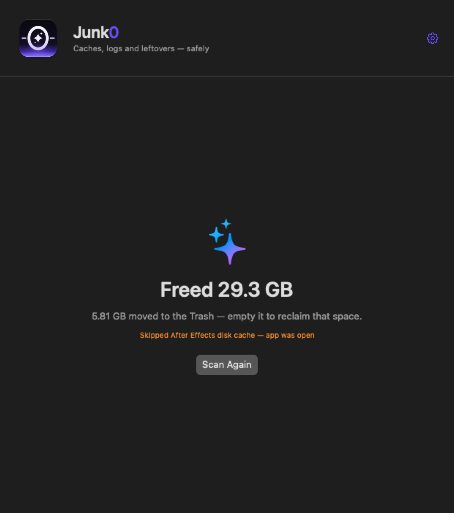

The result screen shows:

- **Freed** — real free space gained on your disk.
- **Moved to the Trash** — space you get back once you empty the Trash.
- **Skipped** — groups whose app was open.
- **Couldn't be removed** — items that were in use or protected (harmless; try again later).

---

## 7. Use cases — step by step

### A. "My disk is suddenly full and I edit video"

The most common case: After Effects and Premiere caches have grown to tens or hundreds of GB.

1. Save your work and **quit After Effects, Premiere Pro and Media Encoder**.
2. Open Junk0 → wait for the scan.
3. Make sure **After Effects disk cache**, **After Effects log files** and **Adobe Media Cache + Peak files** are on.
4. Click **Clean** → confirm.
5. Optional: in After Effects, *Settings → Media & Disk Cache*, set a **maximum disk cache size** so it can't grow unchecked again.

*Expect:* often 20–200 GB. First previews afterwards are slower while caches rebuild.

### B. "I'm in the middle of three projects — don't touch them"

1. Click **⚙** → **Excluded folders → Add Folder…**
2. Select the three project folders (⌘-click to pick several) → **Add**.
3. **Done & Rescan.**
4. Clean as usual. Previews, autosaves and anything else inside those folders are left completely alone.

### C. "Clean up old Premiere projects but keep current ones"

1. **⚙** → **Project folders** → add the drive or folder where your projects live.
2. Set the age, e.g. **30 days**, so anything you touched this month is ignored.
3. Add active projects to **Excluded folders** (see B).
4. **Done & Rescan** → **Old Premiere preview renders → Review…**
5. Keep the ticks on finished projects, untick anything you're unsure of → **Done** → **Clean**.
6. For autosaves, open **Old Premiere autosaves → Review…** and tick only what you're sure you don't need.
7. Empty the Trash when you're happy.

### D. "Downloads is full of installers"

1. **Installers in Downloads → Review…**
2. Use 🔍 to check anything you don't recognise — a `.dmg` can contain project files.
3. Tick the installers of apps you've already installed → **Done** → **Clean**.

### E. "I upgraded Adobe Creative Cloud apps"

After a yearly Adobe upgrade, settings and plugin data of the old version stay behind
(Photoshop UXP plugin storage alone can be ~2.5 GB per version).

1. **Old Adobe version leftovers → Review…**
2. Untick any version you still have installed and use.
3. **Done** → **Clean** → empty the Trash.

### F. "Developer machine: Python, Node, AI tools"

1. Make sure no install or model download is running.
2. Turn on **Developer caches** → **Clean**.
3. The next `pip install`, `npm install` or model load downloads what it needs again.

### G. "Monthly maintenance"

Once a month: quit heavy apps → open Junk0 → **Clean** with defaults → empty the Trash.
Defaults are deliberately conservative: only caches and clearly-old leftovers are selected.

### H. "I share a OneDrive / iCloud project folder with a team"

Leave shared folders out of **Project folders**, or add them to **Excluded folders**.
If they are scanned, their files show the orange *cloud folder* warning and are never pre-selected.

### I. "I edit in DaVinci Resolve or Final Cut Pro"

1. Quit Resolve / Final Cut.
2. If your Resolve cache or Final Cut libraries live on an external drive, add it under **⚙ → Project folders**.
3. **DaVinci Resolve render cache → Review…** — finished projects are ticked, projects used in the last *N* days are not.
4. **Final Cut Pro generated files → Review…** — render and analysis files are ticked; tick optimized/proxy media only for
   projects whose original media is safely available.
5. **Done → Clean**, then empty the Trash when you are happy.

*Expect:* often 10–200 GB on an active editing Mac. First playback of a cleaned project re-renders.

### J. "I use Affinity, Pixelmator or CapCut"

1. Quit the apps you want cleaned.
2. **App Store app caches → Review…** — each app is listed by name; untick any you want to keep warm.
3. **CapCut cache** is a switch — only the cache folder is removed, never your drafts.
4. **Clean.**

---

## 8. How much space can I expect to get back?

It depends entirely on what you use. Typical ranges:

| Setup | Typical result |
|---|---|
| Heavy After Effects / Premiere user, never cleaned | 50–300 GB |
| Occasional video editor | 10–50 GB |
| Office user with Chrome, Teams, Office | 2–10 GB |
| Developer with Python / Node / AI models | 5–30 GB |

On the Mac this app was built for, the first clean freed **327 GB** — 133 GB of it was After Effects log files.

---

## 9. FAQ

**Is it safe?**
It only removes caches and logs that apps rebuild, plus files you explicitly tick (which go to the Trash).
It can't touch anything outside your home folder or anything that needs an admin password.
Every rule is listed in [SAFETY.md](SAFETY.md).

**Will I lose my browser logins, bookmarks or history?** No. Only cache folders are removed.

**Will I lose Premiere / After Effects projects?** No. Project files are never in a cache group. Autosaves are only
listed if they're older than your chosen age, are never pre-selected, and go to the Trash.

**Will my Adobe settings, workspaces or shortcuts reset?** Not for the versions you use — the newest version's
settings are always kept. Only folders of older versions are listed.

**Why is a group locked?** Its app is open. Deleting a cache while the app is using it can make the app misbehave.
Quit the app and press **↻**.

**Why didn't my free space go up by the full amount?** Files moved to the Trash still use space until you empty it.
macOS may also take a moment to update the free-space figure.

**Does it send any data anywhere?** No. It has no network code at all.

**Why does it need no password?** It only works inside your own user folder, which you already own.

**Can I undo a clean?** Reviewed files: yes, from the Trash (*Put Back*). Caches and logs: no — but apps rebuild them.

**Does it run in the background?** No. It only does something when you open it and click Clean.

**Does it work on Intel Macs?** Yes. It's a universal app for Apple Silicon and Intel, macOS 12 or later.

**Why does macOS say it can't verify the developer?** The app isn't notarized by Apple yet. See [Install](../README.md#install).

---

## 10. Troubleshooting

| Problem | Fix |
|---|---|
| *"Junk0 can't be opened because Apple cannot check it for malicious software."* | System Settings → Privacy & Security → **Open Anyway**. Only once. |
| A group stays locked after quitting the app | Some apps keep a helper running for a few seconds. Wait, then press **↻**. |
| *"N items couldn't be removed"* | Those files were in use. Quit the related app and clean again. |
| Scan seems slow | Large project folders take time to search. Remove very large drives from *Project folders* if you don't need them. |
| Premiere previews not found | Add the folder that contains your projects to *Project folders*. Previews live next to projects by default. |
| Free space didn't increase much | Empty the Trash; check the result screen for skipped groups. |

---

## 11. Glossary

| Term | Meaning |
|---|---|
| **Cache** | Temporary copies apps make to work faster. Safe to delete; the app recreates them. |
| **Disk cache (After Effects)** | Rendered frames saved to disk so previews replay instantly. |
| **Media Cache / conformed audio** | Audio converted by Adobe apps into an internal format (`.cfa`) for smooth playback. |
| **Peak files** | Waveform drawings for audio (`.pek`). |
| **Preview renders** | Video Premiere renders for smooth timeline playback (the green bar). |
| **Autosave** | Copies of your Premiere project saved automatically every few minutes. |
| **Log file** | Plain-text diagnostic record an app writes while running. |
| **.dmg / .pkg** | Disk image / installer package — usually how Mac apps are downloaded. |
| **Excluded folder** | A folder Junk0 promises never to scan or touch. |
| **Notarization** | Apple's malware check for apps distributed outside the App Store. |
